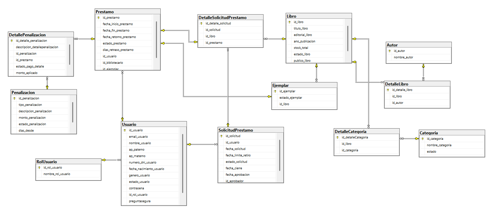

# Sistema de biblioteca universitaria

Aplicación de escritorio para gestionar el catálogo, las reservas, los préstamos y las penalizaciones de una biblioteca académica. Está desarrollada en **Visual Basic .NET, Windows Forms y SQL Server**, con una arquitectura de cinco capas.

El sistema permite que el lector solicite libros desde su propia interfaz y que el bibliotecario apruebe la solicitud antes de realizar la entrega presencial.

## Diagrama de la base de datos

Relaciones entre usuarios, libros, ejemplares, solicitudes, préstamos y penalizaciones.

<<<<<<< HEAD

=======

>>>>>>> 36b3fadaa4bc61a9498961a3a8b0098b64b09468

## Usuarios y funciones

| Rol | Funciones principales |
| --- | --- |
| Lector / Estudiante | Consultar el catálogo, formar un carrito, solicitar libros y consultar sus solicitudes, préstamos y penalizaciones. |
| Bibliotecario | Aprobar o rechazar solicitudes, entregar ejemplares, registrar préstamos y devoluciones, y gestionar libros, autores, categorías, ejemplares y penalizaciones. |
| Administrador | Realizar las funciones del bibliotecario y gestionar usuarios, roles y estados de las cuentas. |

También se incluyen registro de lectores, recuperación de contraseña mediante pregunta de seguridad y comprobantes de las operaciones.

## Organización del proyecto

| Carpeta | Responsabilidad |
| --- | --- |
| `capaConexion/` | Configuración y apertura de conexiones a SQL Server; soporte de transacciones. |
| `capaDatos/` | Entidades, datos compartidos y contratos de validación. |
| `capaDAO/` | Consultas SQL, lectura de resultados y persistencia. |
| `capaNegocio/` | Reglas de negocio, permisos, cálculos y seguridad. |
| `capaInterfaz/` | Formularios de Windows Forms y presentación de resultados. |
| `Utiles/` | Auxiliares visuales usados por los formularios; es necesaria para compilar. |
| `Recursos/` | Imágenes y recursos gráficos. |
| `sql/` | Script consolidado de la base de datos y datos de demostración. |

El flujo de llamadas es **Interfaz → Negocio → DAO → Conexión → SQL Server**. La capa Datos proporciona los modelos y contratos compartidos.

## Cómo iniciar el sistema

### Requisitos

- Windows y SDK de **.NET 10**.
- SQL Server; la conexión predeterminada utiliza SQL Server Express.
- SQL Server Management Studio (SSMS) para preparar la base.
- Visual Studio compatible con .NET 10, si se utiliza ese entorno.

### Preparar la base de datos

1. Para una instalación nueva, crea una base **vacía** llamada `distribuidos-II` en la instancia `.\SQLEXPRESS`.
2. Selecciona esa base en SSMS y ejecuta `sql/bd_fdinal_biblioteca.sql`.
3. El archivo incluye el esquema y casos de demostración para lectores, personal, solicitudes, préstamos y penalizaciones.

**El script consolidado crea una base nueva; no actualiza una existente.** Los datos y tarifas incluidos son ejemplos para trabajar con el proyecto.

Si utilizas otra instancia o nombre de base, configura `BIBLIOTECA_CONNECTION_STRING` antes de abrir la aplicación. Ejemplo en PowerShell, con autenticación de Windows:

```powershell
$env:BIBLIOTECA_CONNECTION_STRING = 'Data Source=.\SQLEXPRESS;Initial Catalog=distribuidos-II;Integrated Security=SSPI;TrustServerCertificate=True;'
```

### Compilar y ejecutar

Desde la carpeta que contiene `Distribuidos-2026II.slnx`:

```powershell
dotnet restore Distribuidos-2026II.slnx
dotnet build Distribuidos-2026II.slnx --no-restore
dotnet run --project capaInterfaz/capaInterfaz.vbproj
```

Los comandos restauran dependencias, compilan y abren el inicio de sesión. En Visual Studio, abre la solución y establece `capaInterfaz` como proyecto de inicio.

## Flujo de una reserva y un préstamo

1. El lector consulta el catálogo y agrega títulos al carrito.
2. Confirma el carrito para generar **una solicitud con varios libros**.
3. El bibliotecario revisa la solicitud y la aprueba o rechaza.
4. Si está aprobada y vigente, el lector acude a recoger los libros.
5. El bibliotecario selecciona los ejemplares físicos y confirma la entrega completa. Se registra un préstamo por ejemplar.
6. Al devolverlos, se cierra cada préstamo y se registra la penalización por retraso, si corresponde.

**Libro** representa el título del catálogo; **Ejemplar** representa una copia física. La solicitud se realiza por título y el préstamo se registra por copia.

## Reglas que debes conocer

- Cada lector puede tener **una solicitud vigente**. El carrito admite títulos distintos, con una copia por título.
- La reserva mantiene disponibilidad durante **cinco días desde la solicitud**. Aprobarla no reinicia el plazo; al vencer, libera la disponibilidad.
- El préstamo dura **cinco días calendario desde la entrega presencial**.
- El límite es de **cinco ejemplares pendientes de devolución en total**, aunque pertenezcan a préstamos diferentes. Los vencidos también cuentan; devolver uno libera un cupo.
- Las penalizaciones pendientes o con pago por revisar bloquean nuevas solicitudes y préstamos.
- La mora utiliza un **importe fijo por tramo**: se aplica el tramo activo de mayor umbral alcanzado. Los tramos no se suman ni se multiplican por los días de retraso.
- Las reservas vigentes se consideran al calcular la disponibilidad para préstamos en ventanilla.

## Pautas para trabajar en el proyecto

- Mantén la arquitectura de cinco capas: los formularios llaman a Negocio y las consultas SQL permanecen en DAO.
- Sigue el patrón de `usuarioDAO`: `query`, `cn`, `cmd`, `dr`, parámetros tipados, lectura con `Read()` y manejo de `SqlException`.
- Conserva las transacciones de las operaciones que deben completarse juntas y las validaciones de disponibilidad dentro de ellas.
- Las contraseñas y respuestas de seguridad se guardan mediante hashes; la pregunta permanece visible.
- Conserva los archivos `.vb`, `.Designer.vb` y `.resx` asociados a los formularios.
- Consulta `AGENTS.md` para las pautas de contribución. No incluyas `bin/`, `obj/`, `.vs/` ni registros de compilación entre los cambios del proyecto.
